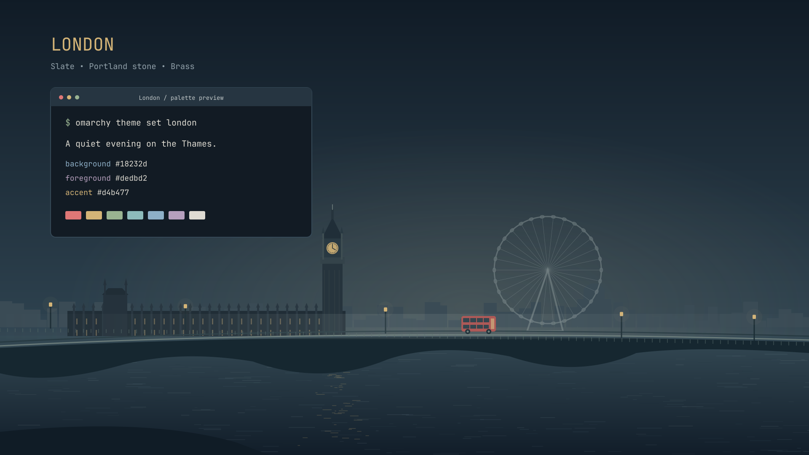

# London

A dark Omarchy theme inspired by an evening on the Thames: slate blue,
Portland stone, warm brass, and restrained London red.



## Install

```sh
omarchy theme install https://github.com/clear-built-dev/omarchy-london-theme
```

The package contains exactly three wallpapers:

- **London** — Westminster, Big Ben, the London Eye, and a red double-decker.
- **Buckingham Palace** — architectural pen-and-pencil drawing of the palace and Victoria Memorial.
- **Windsor Castle** — architectural pen-and-pencil drawing with a classic red telephone box.

All three wallpapers are **6144 × 3456 (6K)**. London is rendered from SVG. The palace and castle sketches are carefully upscaled from their approved originals with restrained sharpening; this preserves their artwork rather than inventing new fine detail. Cycle backgrounds with `omarchy theme bg next`.

## Optional animation

Install the separate [London Motion plugin](https://github.com/clear-built-dev/omarchy-london-motion)
for a moving bus, rotating London Eye, local-time Big Ben clock, waving flags, time-of-day lighting, and optional live weather.
The saved wallpapers already use the slate-blue atmospheric palette, including
in the wallpaper carousel and when the plugin is disabled. The plugin adds
dynamic lighting, weather and motion using its own uncoloured render sources. The marketplace does
not install bundled plugin code, so the animation is a separate, explicit step.

## Palette and font

| Role | Colour |
| --- | --- |
| Background | `#18232d` |
| Raised surface | `#263541` |
| Text | `#dedbd2` |
| Focus / accent | `#d4b477` |
| Blue | `#8eafc7` |
| Red | `#df7776` |
| Green | `#99b391` |

Recommended: **JetBrainsMono Nerd Font**, Regular weight, already the default
on the tested Omarchy installation. Theme installation does not change fonts.

```sh
omarchy font set "JetBrainsMono Nerd Font"
```

Omarchy generates application colours from `colors.toml`. Tested with Omarchy
4.0.6-1; other releases have not been verified.

## Artwork and license

London is original vector artwork. Buckingham Palace and Windsor Castle are
AI-assisted pencil illustrations created with OpenAI image generation and
refined under the author's direction. Their original source images are kept in
`artwork/` for reproducible 6K exports. See [ARTWORK.md](ARTWORK.md).

The preview is a composed demonstration of the palette and wallpaper, not a
screenshot of a private desktop. No font files are bundled.

MIT license; see [LICENSE](LICENSE). Independent community theme, unaffiliated
with Omarchy or the institutions depicted.
